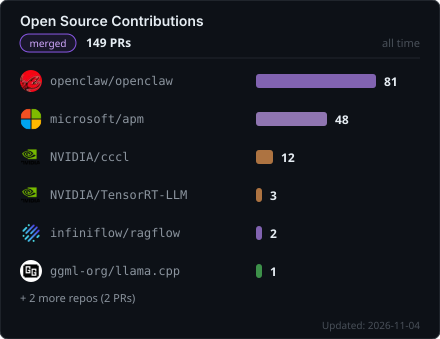

## Hi, I'm Eden 👋

I build AI agents and automation tools for everyday problems, and I fix the open-source infrastructure they run on. 
Python · TypeScript · CUDA C++ · Taiwan 🇹🇼

**149 merged PRs** in OpenClaw, Microsoft & NVIDIA &nbsp;·&nbsp; **⭐ 1.8k** on ReelMimic &nbsp;·&nbsp; **3 competition awards**

### 🚀 Things I built

| Highlight | Project |
|:--|:--|
| **⭐ 1.8k stars** | **[ReelMimic](https://github.com/edenfunf/reelmimic)**: a multi-agent harness that turns Claude Code or Codex into a video crew. Show it a video you love: up to 6 agents build a new one in the same style, and a fresh agent reviews every shot, so no agent grades its own work. |
| **🏆 Nantou track winner** MODA Civic Action Hub 2026 · 4 of 28 finalists | **[AidFlow](https://github.com/edenfunf/aidflow)**: disaster reporting platform built with Nantou County Government. Citizens report without logging in, nearby reports merge into cases, and county staff triage them. [Demo site](https://aidflow.tw) |
| **🏆 Merit Award** DIGITIMES GenAI Hackathon 2026 | **[Family Avatar](https://github.com/edenfunf/tshu-pinn-brack)**: grandparents speak Taiwanese, and an AI family member answers on video in ~2 s. Runs end to end on one A10G GPU. |
| **🏆 Winning Team** MODA Civic Tech Challenge | **[ResQLink](https://github.com/edenfunf/ResQLink)**: describe a disaster in one sentence; an AI agent picks from 72 modules and generates the whole relief system. |
| **📈 1.72× tokens/s** −42% cost per token | **[TuneForge](https://github.com/edenfunf/tuneforge)**: tunes LLM inference on Arm64 cloud. Claude reads hardware counters and proposes the next experiment; the harness changes one setting at a time, measures it, and rejects anything that hurts model quality. |
| **📦 `pip install promptc`** | **[promptc](https://github.com/edenfunf/promptc)**: grades your Claude Code setup (A–F) for duplicated skills and wasted context. |

### 🌍 Open source

| Project | Merged PRs | What I worked on |
|:--|:--:|:--|
| **[OpenClaw](https://github.com/openclaw/openclaw)** ⭐ 394k | [**81**](https://github.com/openclaw/openclaw/pulls?q=is%3Apr+author%3Aedenfunf+is%3Amerged) | 55 PRs on the LINE channel: no lost messages, retries, Flex cards, group mentions, tap-to-answer buttons |
| **[Microsoft APM](https://github.com/microsoft/apm)** ⭐ 4.2k | [**48**](https://github.com/microsoft/apm/pulls?q=is%3Apr+author%3Aedenfunf+is%3Amerged) | MCP config, GitHub Enterprise auth, Windows encoding, the `marketplace audit` command |
| **[NVIDIA CCCL](https://github.com/NVIDIA/cccl)** · **[TensorRT-LLM](https://github.com/NVIDIA/TensorRT-LLM)** | [**15**](https://github.com/search?q=is%3Apr+author%3Aedenfunf+is%3Amerged+org%3ANVIDIA&type=pullrequests) | Parallel `is_heap_until`, single-pass `is_partitioned`, async polling instead of busy-wait |
| **[llama.cpp](https://github.com/ggml-org/llama.cpp)** · **[RAGFlow](https://github.com/infiniflow/ragflow)** · **[openai-python](https://github.com/openai/openai-python)** · more | [**5**](https://github.com/search?q=is%3Apr+author%3Aedenfunf+is%3Amerged+-user%3Aedenfunf+-org%3Aopenclaw+-org%3Amicrosoft+-org%3ANVIDIA&type=pullrequests) | CUDA norm kernels past 65,535 channels, leaked DB connections, streaming fixes |

→ [See all merged PRs](https://github.com/search?q=is%3Apr+author%3Aedenfunf+is%3Amerged+-user%3Aedenfunf&type=pullrequests&s=created&o=desc)

<b>Merged in the last 30 days</b> (auto-updated weekly)

 

<!-- MERGED_PRS_START -->

<!-- MERGED_PRS_END -->

### 📫 Contact

[X / Twitter](https://x.com/Edenfanf) · fya973619@gmail.com
